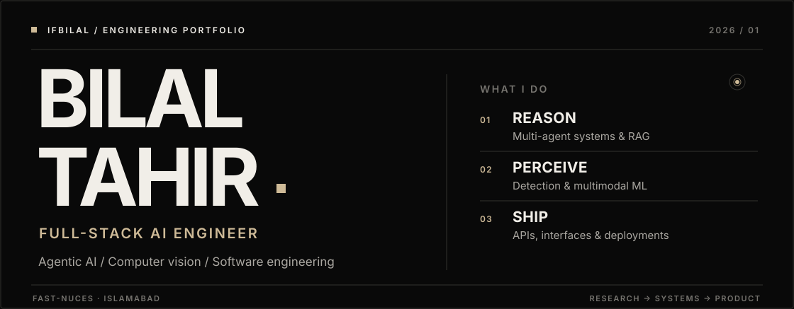
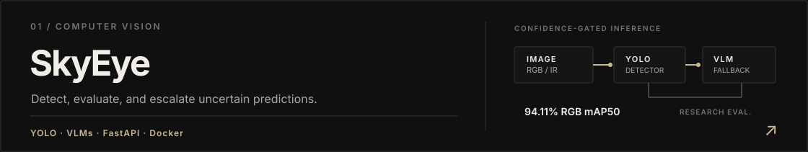
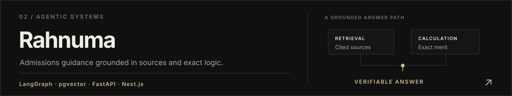
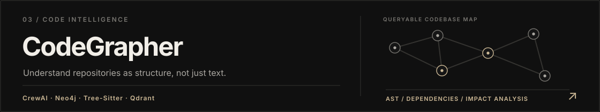
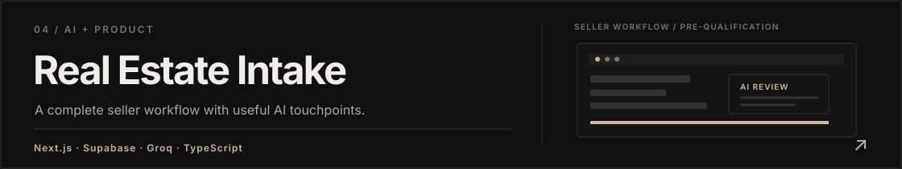
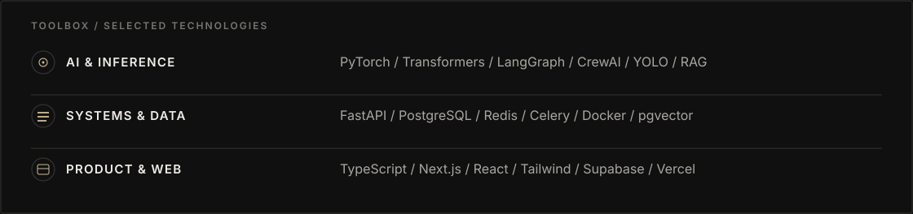
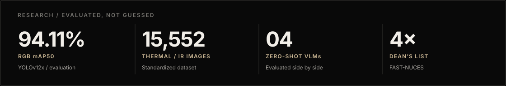
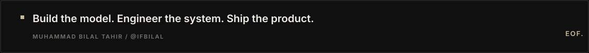

<!--
  @IfBilal · GitHub Profile / Black Edition
  Built around the actual CV and public GitHub projects of Muhammad Bilal Tahir.
  Keep this README.md at the root of github.com/IfBilal/IfBilal.
  All visual assets are local. No script tags, external stat counters, or remote GIF services.
-->

<div align="center">



<br />


<br />

<a href="https://github.com/IfBilal?tab=repositories"></a>
<a href="https://www.linkedin.com/in/m-bilaltahir/"></a>
<a href="mailto:muhammadbilaltahir06@gmail.com"></a>

</div>

<br />

## About

**Models are components. The system is the product.**

I'm **Muhammad Bilal Tahir**, a **Full-Stack AI Engineer** and Software Engineering student at **FAST-NUCES**. I work across the parts of intelligent software that tend to get treated as separate disciplines: **model evaluation, agent orchestration, backend architecture, databases, and the interfaces people actually use.**

My work has taken me from **RGB/thermal object detection research** to **agent-driven document processing**, **natural-language workflow engines**, and **full-stack applications** shipped for real clients.

I care about the details that make AI useful beyond a demo: where data comes from, whether an answer can be verified, which operations should be deterministic, what happens when confidence is low, and how the whole thing gets deployed.

`Full Stack Developer @ Markhor Systems`  ·  `BS Software Engineering @ FAST-NUCES`  ·  `Islamabad, Pakistan`

---

## 01 / Selected work

*Four projects. Four different problems. One engineering approach: make the system around the intelligence just as deliberate as the intelligence itself.*

<a href="https://github.com/IfBilal/UAV-Dependability-lab-Air-Object-Detection">
  
</a>

**SkyEye** — [Explore repository ↗](https://github.com/IfBilal/UAV-Dependability-lab-Air-Object-Detection)  
A deployable aerial-object detection application built from work at the NCRA UAV Dependability Lab. It combines YOLO detectors and four zero-shot VLMs, with **confidence-gated adaptive fallback**, batch inference, and persistent run history. The key design choice is *not* to send every image through a slower model when a confident detector can handle it.

<a href="https://github.com/IfBilal/rahnuma">
  
</a>

**Rahnuma** — [Explore repository ↗](https://github.com/IfBilal/rahnuma)  
A LangGraph-powered admissions advisor for Pakistani students. **Cited RAG** handles prospectus-backed answers, while **deterministic calculators** handle university merit rules. Built with FastAPI, Next.js, PostgreSQL/pgvector, and Clerk, with persistent student profiles.

<a href="https://github.com/IfBilal/CodeGrapher">
  
</a>

**CodeGrapher** — [Explore repository ↗](https://github.com/IfBilal/CodeGrapher)  
Turns repositories into queryable architecture knowledge. A **CrewAI multi-agent pipeline** combines **Tree-Sitter/AST parsing**, Neo4j, and Qdrant to map structure, identify anti-patterns, and trace potential change impact. Background work runs through Celery and Redis.

<a href="https://github.com/IfBilal/Complete-Home-Real-Estate-Seller-Intake-Platform">
  
</a>

**Real Estate Intake Platform** — [Explore repository ↗](https://github.com/IfBilal/Complete-Home-Real-Estate-Seller-Intake-Platform)  
An end-to-end seller onboarding experience: guided forms, address autocomplete, room media uploads, a management dashboard, and AI-powered checks/pre-qualification. This one is about a **useful business workflow**, not an AI demo looking for a problem.

<details>
<summary><b>More repositories</b></summary>
<br />

- **[SholaX](https://github.com/IfBilal/SholaX)** — a Next.js MVP with a marketing site, client analytics dashboard, and role-based admin portal.
- **[CS50 AI problem sets](https://github.com/IfBilal/cs50ai-problem-sets)** — practical implementations spanning search, logic, probability, optimization, machine learning, and language.
- **[All repositories ↗](https://github.com/IfBilal?tab=repositories)** — smaller builds, experiments, and coursework.

</details>

---

## 02 / Engineering toolkit



**AI, agents & vision**  
`Python` · `PyTorch` · `Hugging Face` · `LangChain` · `LangGraph` · `LangSmith` · `CrewAI` · `DSPy` · `RAG` · `MCP / FastMCP` · `Ragas` · `Guardrails` · `YOLO` · `RF-DETR` · `VLMs`

**Backend, data & infrastructure**  
`FastAPI` · `Node.js / Express` · `PostgreSQL / pgvector` · `MongoDB` · `SQL Server` · `Neo4j` · `Qdrant` · `Redis` · `Celery` · `BullMQ` · `Docker` · `Kubernetes` · `Azure Functions` · `REST APIs` · `JWT / Clerk`

**Interfaces, products & tools**  
`TypeScript / JavaScript` · `React` · `Next.js` · `Tailwind CSS` · `Streamlit` · `Supabase` · `Socket.IO` · `Vercel` · `Railway` · `Coolify` · `Git / Linux` · `Postman`

---

## 03 / Research, measured



During my **Computer Vision Research Internship at NCRA UAV Dependability Lab**, I standardized **14,235 RGB** and **15,552 thermal/IR** aerial-object images and conducted detector comparisons across **YOLOv8, YOLOv10, YOLOv11, YOLOv12, and RF-DETR**.

The selected **YOLOv12x RGB** detector reached **94.11% mAP50 / 92.26% F1**; **YOLOv10x IR** reached **66.57% mAP50 / 76.27% F1**. I also evaluated **InternVL2-8B, BLIP-2, Qwen2.5-VL-7B, and DeepSeek-VL-7B-Chat**, then designed the confidence-gated fallback architecture used in SkyEye.

<sub>These are internship evaluation metrics for the specified datasets, not claims about general-world or production performance.</sub>

---

## 04 / Experience

**Full Stack Developer · [Markhor Systems](https://github.com/IfBilal)**  
`APR 2026 — PRESENT` · Remote, Islamabad  
Client-facing full-stack delivery, including a medical learning platform with **Zoom automation, attendance tracking, recording uploads, and live community chat**.

**Computer Vision Research Intern · NCRA UAV Dependability Lab**  
`JUN — AUG 2026` · Hybrid, Islamabad  
Aerial-object data curation, **detector benchmarks**, RGB/IR model training, zero-shot VLM evaluation, and the **SkyEye adaptive fallback** architecture.

**AI Engineer Intern · Prompt To Flow, National Incubation Center**  
`AUG 2026` · On-site, Islamabad  
Built a **natural-language-to-executable-workflow engine** with FastAPI, Groq/Gemini provider fallback, per-tenant credit controls, and API key rotation.

**Software Engineer Intern · RainMakerz**  
`NOV 2025 — JAN 2026` · Remote, San Francisco  
Contributed to a serverless **Python/FastAPI backend on Azure Functions** inside a **19-agent document processing system**, with exposure to DSPy and LangChain/LangGraph pipelines.

---

## 05 / Beyond the repository

- **BS Software Engineering**, FAST-NUCES Islamabad · **3.67/4.00 CGPA** · **4× Dean's List** · Expected **2028**.
- **4× Lab Demonstrator** at FAST-NUCES: Object-Oriented Programming and Data Structures labs, including cohorts of **75–100+ students**.
- **Vice Head, AI Battle Arena** — NASCON 2026.
- **Runner-up** — Prompt & Play Competition, Soventure 2025.
- **Coursework & certificates** — Neural Networks & Deep Learning, RAG, AI Agents with MCP, and Harvard CS50's Introduction to AI with Python.

---

## 06 / The way I build

```text
01  Ground model outputs in evidence.
02  Keep deterministic operations deterministic.
03  Measure accuracy, failure modes, and fallback behavior.
04  Treat APIs, state, auth, and UX as part of the AI system.
05  Ship the thing people can actually use.
```

I'm interested in **agentic software, reliable retrieval, multimodal perception, and full-stack AI systems**—especially projects where engineering the whole product matters as much as choosing the model.

<div align="center">

<a href="mailto:muhammadbilaltahir06@gmail.com"></a>
<a href="https://www.linkedin.com/in/m-bilaltahir/"></a>
<a href="https://github.com/IfBilal?tab=repositories"></a>

<br /><br />



<sub>Designed for the GitHub renderer · Self-hosted vector artwork · Subtle, locally stored motion · No external stats service</sub>

</div>
